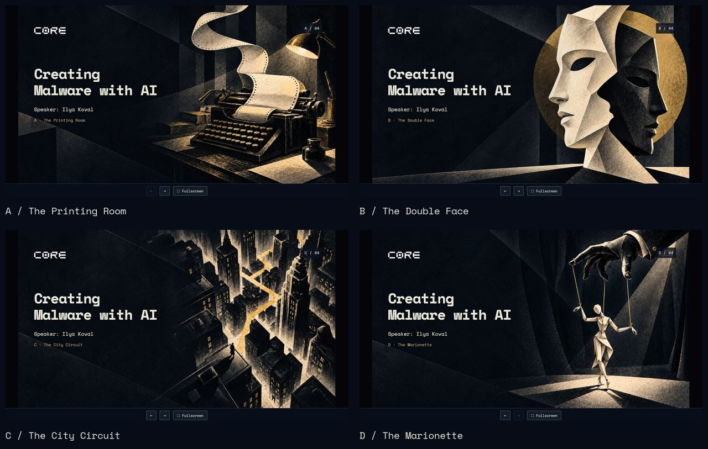
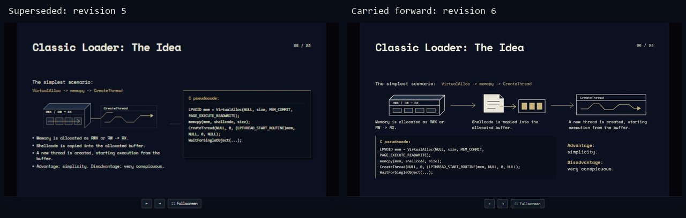
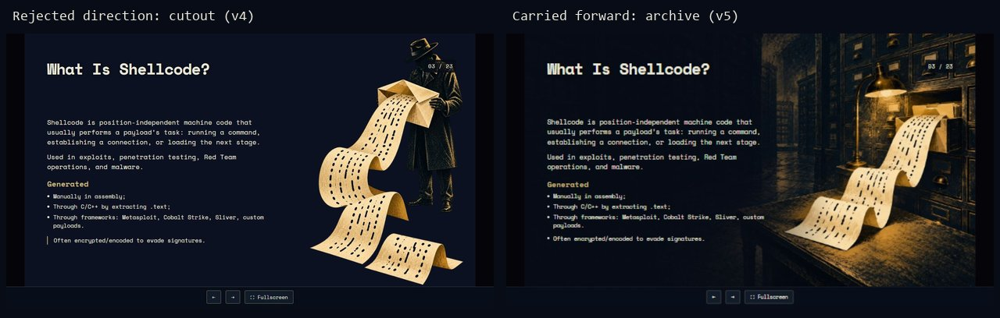
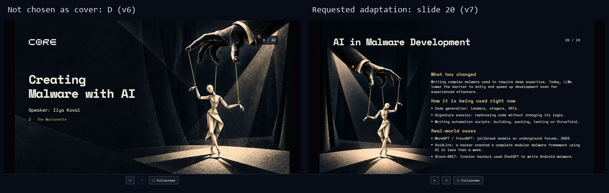

# Four bounded design cases

Read when a new deck has a similar design problem, not as a gallery to copy blindly. These compact whole-frame QA comparisons are derived from the Malware activity; general identity and rhythm were informed by both Matrix and Malware. Original screenshots, generated PNGs, prompts and reports remain in the archive. Paths in historical manifests may describe former folder locations; they are provenance, not portable build instructions.

**Status vocabulary:** selected = explicit user choice; rejected = user requested a different direction; superseded = later version replaced it; carried forward = retained in subsequent delivered revisions. A technical report's PASS or a filename such as `Final` is not user approval.

## 1. Different concepts make cover selection useful

The actual search included A—The Printing Room, B—The Double Face, C—The City Circuit, D—The Marionette. **C was selected by the user** for the cover. A, B and D were nonselected alternatives, not failures. D later became useful on a different slide.

- **Transferable:** compare different actions/metaphors while holding typography, real title, logo and controls constant. Select the direction before polishing it. The new workflow defaults to three directions; this historical four-option board does not add a fourth requirement.
- **Specific to this activity:** noir city, paper production and puppet imagery; navy/milk/gold palette.
- **Provenance:** [cover choices and selected C](../../../../draft/malware_ai_talk_source/qa/revision-v6/cover-options.json), [prompts](../../../../draft/malware_ai_talk_source/revision-v6-image-prompts.json), [revision 6 report](../../../../draft/malware_ai_talk_source/qa/revision-v6/REPORT.md).

## 2. Change the organization when alignment edits stop helping

Revision 5 is **superseded**. It placed a scenario, several explanations and small vector elements left of a code panel; repeated size/alignment changes had not resolved the weakness. Revision 6, **carried forward in delivery**, reorganized the same material into three visible stages with explanations below, followed by a wide code area and the existing tradeoffs.

- **Transferable:** let a process determine the spatial reading order. Preserve the worthwhile thread and memory visuals while changing their role and scale. Distinguish conceptual organization from SVG polish.
- **Specific:** this example's existing API names, pseudocode and technical explanations; it is a layout case, not a source of new technical material.
- **Provenance:** [revision 5 report](../../../../draft/malware_ai_talk_source/qa/revision-v5/REPORT.md), [revision 6 report](../../../../draft/malware_ai_talk_source/qa/revision-v6/REPORT.md), [original full comparison](../../../../draft/malware_ai_talk_source/qa/revision-v6/slide-06-comparison.jpg).

## 3. Choose an image's role before fixing its edges

The transparent figure/paper direction in revision 4 was **rejected by the user as visually weak**. Revision 5's archive and card catalogue, with a complete punched sheet as the focal point, was **carried forward**. Later revisions refined line breaks and spacing.

- **Transferable:** a cutout and an environment offer different composition, scale and context. A coherent scene can create natural reading space; removing a background is not automatically an improvement. Keep the complete focal subject outside the copy area and verify the assembled slide.
- **Specific:** perforated paper as the shellcode metaphor and archive-room setting. Do not reuse this room for every unrelated subject.
- **Provenance:** [revision 4 report](../../../../draft/malware_ai_talk_source/qa/revision-v4/REPORT.md), [archive generation prompt](../../../../draft/malware_ai_talk_source/revision-v5-image-prompts.json), [revision 5 report](../../../../draft/malware_ai_talk_source/qa/revision-v5/REPORT.md).

## 4. Recompose a selected motif for a different slide

D was **not selected as the cover**. The user later **requested** its hand and puppet, mirrored left, for slide 20. Revision 7 delivered a recomposed version; this is not evidence of separate user approval of every pixel. The first generation did not respect the quiet title band despite a detailed coordinate prompt. A second targeted iteration moved the whole group below the title and kept the puppet complete.

- **Transferable:** reuse a promising motif without forcing the old crop into a new layout. Brief subject direction, full extremities, title band, copy bounds and invariants. Verify actual output, even when the prompt is exact. Preserve the original and both generation attempts.
- **Specific:** glove, three strings and origami puppet; this slide's right-hand text bounds. Those coordinates are not a universal template.
- **Provenance:** [both prompts and selected iteration](../../../../draft/malware_ai_talk_source/revision-v7-image-prompts.json), [revision 7 report](../../../../draft/malware_ai_talk_source/qa/revision-v7/REPORT.md). The report distinguishes three newly reviewed frames from revision 6's full-deck baseline and retains the offline limitations.

The [image provenance record](../assets/examples/provenance.json) identifies the exact archive screenshots used for these four compact comparisons. Only whole-frame proportional resizing and labels were added; the original art was not edited.

